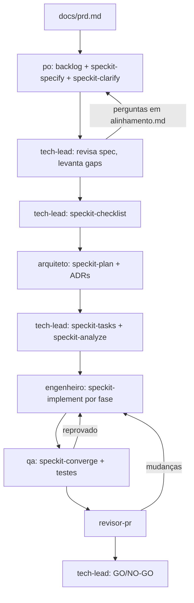

# Atentio

Novo app em construção, desenvolvido com Spec-Driven Development usando o [GitHub Spec Kit](https://github.com/github/spec-kit) (integração `claude`, skills `/speckit-*` em `.claude/skills/`).

- PRD: `docs/prd.md` · Backlog: `docs/backlog.md`
- Constitution: `.specify/memory/constitution.md`
- Specs por feature: `specs/<NNN-feature>/` (`spec.md`, `alinhamento.md`, `plan.md`, `tasks.md`, `qa.md`, ...)
- ADRs: `docs/adr/`

## Comandos

- `make up` / `make down` / `make ps` / `make logs`: plataforma local em Docker
- `make create-platform-admin EMAIL=... NAME=...`: cria o administrador da plataforma
- `make check`: lint, type-check, regras de arquitetura, testes, build e varredura de segredos

Código-fonte em `apps/` (`backend`, `frontend`, `mcp`, `workers`).

## Padrões de arquitetura

As regras completas estão na constitution e nos ADRs 0006, 0007 e 0008. Em resumo:

**Serviços autônomos.** `backend`, `workers` e `mcp` têm dependências, lock, testes e Dockerfile
próprios. Não importam código entre si, e não existe biblioteca compartilhada. Só o backend é dono do
esquema do banco.

**Backend, workers e mcp: Clean Architecture, DDD e SOLID simplificados.** Pacote `app/`, só com as
pastas necessárias:

```text
app/
├── api/v1/          # endpoints finos (jobs/ nos workers, tools/ no mcp)
├── core/            # config, database, logging, security
├── domain/          # entidades, regras e ports; sem frameworks
├── services/        # casos de uso; só domain e ports
├── repositories/    # implementam ports; convertem ORM ↔ domínio; só flush
├── infrastructure/  # adapters que não são persistência (e-mail, hash, probes)
├── models/          # ORM
├── schemas/         # contratos HTTP
└── utils/
```

**Frontend: Next.js com Feature-Driven Architecture.**

```text
src/
├── app/         # rotas finas; só compõem features
├── components/  # UI genérica do Design System
├── features/<feature>/  # components, hooks, services, types + index.ts
├── features/shared/     # negócio usado por mais de uma feature
├── lib/         # utilitários e cliente HTTP
└── types/       # tipos globais
```

Fora da feature, importe só de `@/features/<feature>`. Dentro dela, use imports relativos.
`components/` e `lib/` não importam `features/`. Testes ficam ao lado do código.

**Entre serviços:** rotas em `/api/v1/internal` exigem segredo próprio, e a Evolution API só usa rotas de
instância. Enviar, reagir ou marcar como lida são proibidos (ADR 0009).

**Isolamento:** todo dado de negócio pertence a uma empresa, e cada consulta filtra por ela. Tentativa
de alcançar outra empresa responde como registro inexistente.

## Time de agentes

Os agentes ficam em `.claude/agents/`. A sessão principal orquestra o fluxo, repassa as perguntas entre papéis e chama cada um na ordem abaixo:



| Papel | Agente | Comandos Spec Kit | Entrega |
|---|---|---|---|
| Product Owner | `po` | `speckit-specify`, `speckit-clarify` | backlog, `spec.md`, respostas em `alinhamento.md` |
| Tech Lead | `tech-lead` | `speckit-constitution`, `speckit-checklist`, `speckit-tasks`, `speckit-analyze` | gaps em `alinhamento.md`, `tasks.md`, GO/NO-GO |
| Arquiteto | `arquiteto` | `speckit-plan` | `plan.md`, `data-model.md`, `contracts/`, ADRs |
| Engenheiro | `engenheiro` | `speckit-implement` | código e testes por fase |
| QA | `qa` | `speckit-converge`, `speckit-analyze` | testes adicionais, `qa.md` |
| Revisor de PR | `revisor-pr` | — | revisão do diff (somente leitura) |

## Alinhamento P.O ↔ Tech Lead

Subagentes não conversam diretamente: a sessão principal alterna `tech-lead` (pergunta) e `po` (responde e atualiza a spec) usando `specs/<feature>/alinhamento.md`, até não haver pergunta `aberta`. Perguntas que nenhum dos dois consegue responder são `escalada ao usuário`, e o fluxo para até o usuário responder.

## Convenções

- Código só começa com aprovação explícita do usuário sobre spec, plano e tarefas.
- Nunca commitar direto na `main`; uma branch e um PR por feature (ou por fase, em features grandes).
- Commits no padrão Conventional Commits.
- Nenhum agente inventa requisito de negócio.
- Antes de declarar pronto: testes, lint, type-check e build passando, e `speckit-converge` retornando `Converged`.
