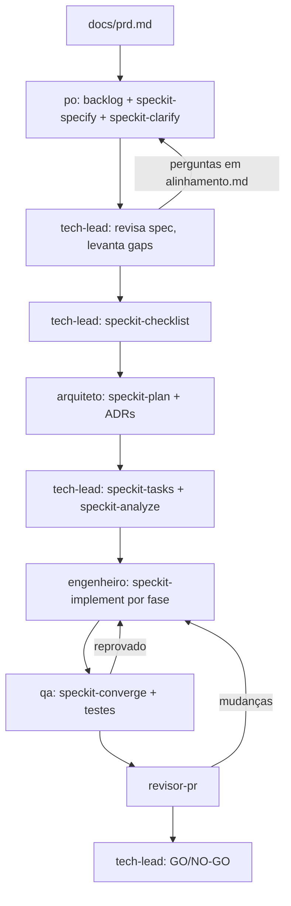

# Judite

Novo app em construção, desenvolvido com Spec-Driven Development usando o [GitHub Spec Kit](https://github.com/github/spec-kit) (integração `claude`, skills `/speckit-*` em `.claude/skills/`).

- PRD: `docs/prd.md` · Backlog: `docs/backlog.md`
- Constitution: `.specify/memory/constitution.md`
- Specs por feature: `specs/<NNN-feature>/` (`spec.md`, `alinhamento.md`, `plan.md`, `tasks.md`, `qa.md`, ...)
- ADRs: `docs/adr/`

## Time de agentes

Os agentes ficam em `.claude/agents/`. A sessão principal orquestra o fluxo, repassa as perguntas entre papéis e chama cada um na ordem abaixo:

| Papel | Agente | Comandos Spec Kit | Entrega |
|---|---|---|---|
| Product Owner | `po` | `speckit-specify`, `speckit-clarify` | backlog, `spec.md`, respostas em `alinhamento.md` |
| Tech Lead | `tech-lead` | `speckit-constitution`, `speckit-checklist`, `speckit-tasks`, `speckit-analyze` | gaps em `alinhamento.md`, `tasks.md`, GO/NO-GO |
| Arquiteto | `arquiteto` | `speckit-plan` | `plan.md`, `data-model.md`, `contracts/`, ADRs |
| Engenheiro | `engenheiro` | `speckit-implement` | código e testes por fase |
| QA | `qa` | `speckit-converge`, `speckit-analyze` | testes adicionais, `qa.md` |
| Revisor de PR | `revisor-pr` | — | revisão do diff (somente leitura) |

## Alinhamento P.O ↔ Tech Lead

Subagentes não conversam diretamente: a sessão principal alterna `tech-lead` (pergunta) e `po` (responde e atualiza a spec) usando `specs/<feature>/alinhamento.md`, até não haver pergunta `aberta`. Perguntas que nenhum dos dois consegue responder são `escalada ao usuário`, e o fluxo para até o usuário responder.

## Convenções

- Nunca commitar direto na `main`; uma branch e um PR por feature (ou por fase, em features grandes).
- Commits no padrão Conventional Commits.
- Nenhum agente inventa requisito de negócio.
- Antes de declarar pronto: testes, lint, type-check e build passando, e `speckit-converge` retornando `Converged`.
