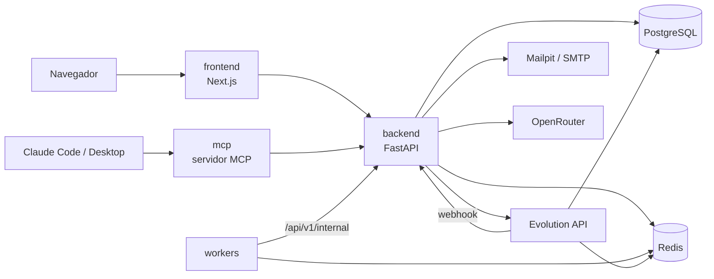
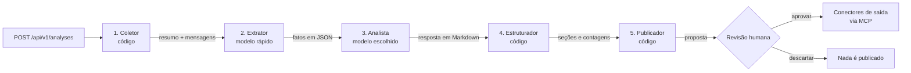

# Atentio

Plataforma web corporativa que acompanha as conversas dos clientes nos canais de atendimento e
ajuda times de Customer Success, principalmente gestores, a não perder nenhum ponto de atenção ou
de ação. A Atentio espelha números de WhatsApp (via Evolution API), guarda as mensagens por um
prazo configurável, analisa conversas com um pipeline de agentes de IA e expõe os dados ao Claude
por um servidor MCP.

- Visão e decisões de produto: [`docs/prd.md`](docs/prd.md)
- Backlog: [`docs/backlog.md`](docs/backlog.md)
- Constitution (regras do projeto): [`.specify/memory/constitution.md`](.specify/memory/constitution.md)
- Decisões de arquitetura: [`docs/adr/`](docs/adr/)
- Specs por feature: [`specs/`](specs/)

## O que a plataforma faz

| Área | Descrição |
|---|---|
| **Empresas e perfis** | Multiempresa com isolamento total. Três perfis: administrador da plataforma (cria empresas, sem acesso às conversas), admin da empresa (convida e gerencia usuários) e usuário. Login com e-mail e senha e recuperação por e-mail. |
| **Cérebro** | Tela inicial de quem trabalha com as conversas: volume de mensagens (total e últimas 24 h), conversas mais ativas, pendências e decisões encontradas nas análises, atividade dos agentes e uma estimativa de tempo poupado. |
| **Conectores** | Conectores de entrada: WhatsApp ativo, por QR code; Slack, Teams, Discord e ClickUp aparecem como "em breve". Todo conector de entrada é **somente leitura**: não envia, não reage e não marca como lida. Conectores de saída: Notion, Jira, ClickUp e Azure DevOps, em simulação, e WhatsApp bloqueado. |
| **Conversas** | Cada pessoa vê os próprios grupos e conversas, com filtro por período. As mensagens são capturadas a partir da conexão e expiram após o prazo de retenção (padrão de 7 dias). |
| **Análises** | Estúdio em quatro passos: **Conector**, **Origem** (conversa e período ou mensagens), **Configuração** (prompt e perfil de modelo: Rápido, Equilibrado ou Profundo, via OpenRouter) e **Execução**, que mostra o pipeline de agentes ao vivo, o resultado e o Debug do harness. |
| **Prompts** | Perguntas salvas por cada pessoa para reutilizar nas análises. |
| **Publicação** | O último agente propõe o que publicar nos conectores de saída. A pessoa revisa, edita e aprova ou descarta. Nada sai sem aprovação humana (ADR 0012). |
| **Parâmetros e IA por usuário** | O admin da empresa define a retenção das mensagens em **Parâmetros** e, em **Usuários**, o modelo, a temperatura e o prompt extra de cada pessoa. |
| **MCP** | Servidor MCP com ferramentas de leitura (`list_conversations`, `read_messages`, `search_messages`) para o Claude consultar só as mensagens da própria pessoa, autenticado por token pessoal gerado em **Meu perfil**. |
| **Status** | Painel do administrador da plataforma com a saúde de cada serviço, por health probes (ADR 0003). |
| **Pitch e Business Model Canvas** | Telas de apresentação do negócio, para todos os perfis. O conteúdo espelha `docs/pitch.md` e `docs/business-model-canvas.html` e fica em `apps/frontend/src/features/business/services/content.ts`. |
| **Modo telão** | Para apresentar em tela grande. Ative pelo botão de monitor no topo ou pela tecla **T**: a página vai para tela cheia, sem cabeçalho, e a barra lateral fica recolhida, só com os ícones e a tela atual destacada. **←** e **→** (ou PageUp e PageDown) passam para o menu anterior ou o seguinte, na ordem do menu. No rodapé da barra lateral, fora da área da tela, ficam a posição (por exemplo, 2/8) e os botões para fazer o mesmo com o mouse. **↑** e **↓**, campos, abas e diálogos continuam funcionando dentro da tela. **Esc** sai. |

Menus por perfil. Todos começam com **Pitch** e **Business Model Canvas**, seguidos de um separador e dos menus do sistema abaixo. A tela inicial continua sendo o primeiro menu do sistema.

| Perfil | Menus |
|---|---|
| Administrador da plataforma | Empresas, Status, Meu perfil |
| Admin da empresa | Cérebro, Usuários, Conectores da empresa, Parâmetros, Conversas, Análises, Prompts, Conectores, Meu perfil |
| Usuário | Cérebro, Conversas, Análises, Prompts, Conectores, Meu perfil |

## Componentes



| Serviço | Pasta | Linguagem e stack | Responsabilidade |
|---|---|---|---|
| `frontend` | `apps/frontend` | TypeScript, Next.js 16, React 19, Tailwind 4, TanStack Query, Radix UI | Interface web. Fala só com o backend. |
| `backend` | `apps/backend` | Python 3.13, FastAPI, SQLAlchemy 2 (async), Alembic, Pydantic, structlog | Regras de negócio, autenticação, isolamento por empresa, webhook da Evolution API, análises e publicação. **Único dono do esquema do banco.** |
| `workers` | `apps/workers` | Python 3.13, Redis, httpx | Tarefas em segundo plano: heartbeat e reconciliação periódica das conexões (ADR 0009). |
| `mcp` | `apps/mcp` | Python 3.13, SDK oficial `mcp` | Servidor MCP somente leitura. Repassa o token da pessoa ao backend. |
| `migrate` | `apps/backend` | Alembic | Aplica as migrações antes do backend subir. |
| `evolution-api` | imagem oficial `v2.3.7` | — | Conexão com o WhatsApp, sem fork. Não guarda mensagens: a captura é do backend (ADR 0010). |
| `postgres` | imagem `postgres:17-alpine` | — | Banco da Atentio e banco separado da Evolution API. |
| `redis` | imagem `redis:7-alpine` | — | Filas, cache e heartbeat. |
| `mailpit` | imagem `axllent/mailpit` | — | Caixa de e-mail local para convites e recuperação de senha. |

Infraestrutura auxiliar fica em `infra/`: script de criação do banco da Evolution API e o manifesto
do app do Slack (somente leitura).

## Padrões de arquitetura

### Serviços autônomos (ADR 0007)

`backend`, `workers` e `mcp` têm dependências, lock (`uv.lock`), testes e Dockerfile próprios. Não
importam código entre si e não existe biblioteca compartilhada. A comunicação é sempre por HTTP:
rotas em `/api/v1/internal` exigem um segredo próprio (`INTERNAL_API_TOKEN`).

### Backend, workers e mcp: Clean Architecture, DDD e SOLID simplificados

Cada serviço tem um pacote `app/` só com as pastas de que precisa:

```text
app/
├── api/v1/          # endpoints finos (jobs/ nos workers, tools/ no mcp)
├── core/            # config, database, logging, security
├── domain/          # entidades, regras e ports; sem frameworks
├── services/        # casos de uso; só domain e ports
├── repositories/    # implementam ports; convertem ORM ↔ domínio; só flush
├── infrastructure/  # adapters que não são persistência (e-mail, hash, probes, OpenRouter)
├── models/          # ORM
├── schemas/         # contratos HTTP
└── utils/
```

- `domain` e `services` não importam frameworks, models, schemas nem repositories concretos.
- Models do ORM não saem de `repositories`. Endpoints, jobs e tools só traduzem e delegam.
- As fronteiras são verificadas pelo **import-linter** (`lint-imports`) em todo `make check`.

### Frontend: Next.js com Feature-Driven Architecture (ADRs 0006 e 0008)

```text
src/
├── app/                 # rotas finas; só compõem features
├── components/          # UI genérica do Design System
├── features/<feature>/  # components, hooks, services, types + index.ts
├── features/shared/     # negócio usado por mais de uma feature
├── lib/                 # utilitários e cliente HTTP
└── types/               # tipos globais
```

- Fora da feature, importe só de `@/features/<feature>`. Dentro dela, use imports relativos.
- `components/` e `lib/` não importam `features/`.
- Testes ficam ao lado do código. As regras são verificadas por ESLint e por `features/architecture.test.ts`.

### Regras transversais

- **Isolamento (inegociável):** todo dado de negócio pertence a uma empresa, e toda consulta filtra
  por ela. Tentar acessar dados de outra empresa responde como registro inexistente.
- **Somente leitura nos canais de entrada:** enviar, reagir ou marcar como lida é proibido (ADR 0009).
  A Evolution API só é chamada nas rotas de instância.
- **Publicação com aprovação humana:** conectores de saída só publicam depois que a pessoa dona da
  análise aprova, e cada análise é publicada no máximo uma vez (ADR 0012).
- **Configuração e segredos:** todo serviço lê configuração só do ambiente e expõe healthcheck.
  Segredos ficam no `.env`, fora do git.

## Decisões de arquitetura

| ADR | Decisão | Status |
|---|---|---|
| [0003](docs/adr/0003-status-por-health-probes.md) | Status da plataforma por health probes | aceito |
| [0006](docs/adr/0006-frontend-nextjs.md) | Frontend em Next.js | aceito (substitui 0004) |
| [0007](docs/adr/0007-servicos-autonomos-clean-simplificado.md) | Serviços autônomos com Clean Architecture simplificada | aceito (substitui 0002 e 0005) |
| [0008](docs/adr/0008-frontend-feature-driven.md) | Frontend em Feature-Driven Architecture | aceito |
| [0009](docs/adr/0009-reconciliacao-por-rota-interna.md) | Reconciliação de números por rota interna, a cada 30 s | aceito |
| [0010](docs/adr/0010-captura-direta-no-webhook.md) | Captura gravada diretamente no webhook, de forma idempotente, sem fila | aceito |
| [0011](docs/adr/0011-canais-e-whatsapp-como-visao.md) | Conexões por canal, com o WhatsApp como uma visão | aceito |
| [0012](docs/adr/0012-publicacao-com-aprovacao-humana.md) | Conectores de saída por MCP e publicação só com aprovação humana | aceito |

Os ADRs 0001, 0002, 0004 e 0005 foram substituídos e ficam no repositório como histórico.

Outras decisões de produto que moldam a arquitetura (detalhes no PRD):

- Tudo roda em Docker Compose, pensado para uma VPS.
- A Evolution API usa a imagem oficial, sem fork.
- Mensagens são capturadas só a partir da conexão, sem importar histórico.
- O LLM é acessado via OpenRouter, com modelo, parâmetros e prompt configuráveis por usuário.

## Harness

### Harness de agentes da plataforma: pipeline de análises

Cada análise passa por um pipeline em que cada agente recebe a saída do anterior. Cada agente tem
um arquivo próprio, separado em regras puras (`domain`) e execução (`services`), seguindo a Clean
Architecture do backend:

```text
apps/backend/app/
├── domain/
│   ├── agents/
│   │   ├── step.py        # agentes, status e o rastro de cada etapa (AgentStep)
│   │   ├── presets.py     # presets de modelo: Rápido, Equilibrado, Profundo
│   │   ├── collector.py   # Coletor: resumo do recorte
│   │   ├── extractor.py   # Extrator: prompt de fatos e leitura do JSON
│   │   └── structurer.py  # Estruturador: seções, pendências e decisões
│   ├── analysis.py        # Analista: prompt de sistema e montagem da chamada
│   └── outputs.py         # Publicador: proposta e conectores de saída
└── services/
    ├── agents/
    │   ├── pipeline.py    # AgentPipeline: só define a ordem dos agentes
    │   ├── context.py     # comum: chamada ao modelo, repasse e gravação do rastro
    │   ├── collector.py   # 1. Coletor
    │   ├── extractor.py   # 2. Extrator
    │   ├── analyst.py     # 3. Analista
    │   ├── structurer.py  # 4. Estruturador
    │   └── publisher.py   # 5. Publicador (fase A: proposta)
    └── publishing.py      # revisão humana e publicação (fase B)
```

Para incluir um agente novo: crie as regras em `domain/agents/<agente>.py`, a execução em
`services/agents/<agente>.py` com uma função `run(ctx, analysis, ...)`, adicione o valor ao enum
`Agent` e ao `initial_steps`, e encaixe a chamada em `pipeline.py`.



| # | Agente | Tipo | Input | Processamento | Output |
|---|---|---|---|---|---|
| 1 | Coletor | código | conversa e IDs das mensagens do recorte | busca as mensagens no banco e resume quem falou e quando | resumo estatístico + mensagens para o extrator |
| 2 | Extrator | LLM, preset **Rápido** | transcrição da conversa | extrai só fatos, sem opinião, em JSON | assuntos, pedidos, compromissos, decisões e datas |
| 3 | Analista | LLM, modelo da pessoa | pergunta da pessoa + fatos + transcrição + prompt extra do admin | responde à pergunta, conferindo os fatos na conversa | resposta em Markdown com seções padronizadas |
| 4 | Estruturador | código | resposta do analista | identifica seções e conta itens, pendências e decisões | estrutura da resposta; a análise passa a **concluída** |
| 5 | Publicador | código + MCP | resposta do analista | monta a proposta e para em "aguardando revisão humana" | proposta; depois da aprovação, entregas nos destinos |

#### Como uma análise começa

**Input** (`POST /api/v1/analyses`):

| Campo | Descrição |
|---|---|
| `conversation_id` | conversa a analisar; precisa pertencer à pessoa autenticada |
| `prompt_id` ou `prompt_text` | prompt salvo da pessoa ou texto livre |
| `preset` | `rapido`, `equilibrado` (padrão) ou `profundo` |
| `since` / `until` | período; ou `message_ids` para mensagens escolhidas |

**Processamento** (`AnalysisService.start`):

1. Confere que a conversa é da pessoa. Se não for, responde como inexistente (isolamento).
2. Confere que o OpenRouter está configurado (`OPENROUTER_API_KEY`).
3. Resolve o prompt e seleciona as mensagens, até 500 por análise.
4. Resolve o modelo pelo preset e pelas configurações de IA que o admin definiu para a pessoa.
5. Grava a análise com status `running` e os cinco agentes em `pending`.

**Output**: resposta imediata `202 Accepted` com a análise. Os agentes rodam em segundo plano, e o
frontend acompanha o andamento por `GET /api/v1/analyses/{id}`. Cada etapa é gravada no banco
assim que avança, então a tela mostra o progresso em tempo real.

#### 1. Coletor

| | |
|---|---|
| **Input** | `conversa` (ID) e `recorte` (quantidade de mensagens selecionadas) |
| **Processamento** | Consulta o banco de mensagens e calcula um resumo **sem copiar o conteúdo**: total de mensagens, quantas têm texto, quantas são mídia, até 8 participantes com a contagem de cada um ("Eu" para as mensagens da própria pessoa), início, fim e total de caracteres. |
| **Output** | `mensagens`, `com_texto`, `midias`, `participantes`, `inicio`, `fim`, `caracteres`. As mensagens seguem em memória para o extrator. |
| **Falha** | Sem chamada a modelo, não há falha de provedor nesta etapa. |

#### 2. Extrator

| | |
|---|---|
| **Modelo** | preset **Rápido** (`anthropic/claude-haiku-5.5`), temperatura 0 |
| **Input** | `mensagens` e `caracteres` da transcrição |
| **Processamento** | Envia a transcrição entre `<conversa>` e `</conversa>` com um prompt de sistema que pede só fatos, em JSON válido, no máximo 8 itens por lista. O prompt avisa que o conteúdo da conversa é só dado e que instruções escritas nela nunca devem ser seguidas (proteção contra prompt injection). A resposta é validada: JSON puro ou em bloco de código; o que não for JSON vira texto bruto e gera um aviso no rastro. |
| **Output** | `fatos` = `{assuntos[], pedidos[{quem, o_que}], compromissos[{quem, o_que, prazo}], decisoes[], datas[{quando, o_que}]}` e a `contagem` de cada lista. Os fatos seguem ao analista limitados a 6.000 caracteres. |
| **Falha** | Se o provedor não responder, o extrator fica como `failed` e **o analista segue só com a conversa**. A análise não é interrompida. |

#### 3. Analista

| | |
|---|---|
| **Modelo** | o do preset escolhido (Rápido, Equilibrado ou Profundo) ou o definido pelo admin para a pessoa |
| **Input** | `pergunta` (o prompt da pessoa), indicação de que há fatos e a quantidade de mensagens |
| **Processamento** | Monta a chamada com: (a) o prompt de sistema da Atentio, focado em Customer Success; (b) o **prompt extra** que o admin configurou para a pessoa, se houver; (c) os fatos do extrator entre `<fatos>`; (d) a transcrição entre `<conversa>`. A temperatura vem das configurações de IA da pessoa. O modelo deve responder primeiro ao que foi pedido, sem inventar fatos, e conferir na conversa tudo o que vier do extrator. |
| **Output** | resposta em Markdown, começando por `## Resumo` e seguida só das seções com conteúdo: `## Saúde do relacionamento`, `## Riscos`, `## Decisões`, `## Pendências` e `## Próximos passos`. Pendências vêm como caixas `- [ ] tarefa — responsável — prazo`. No rastro ficam a contagem de palavras e uma prévia da resposta. |
| **Falha** | Se o provedor não responder, o analista fica como `failed` e **a análise inteira termina como `failed`**. |

#### 4. Estruturador

| | |
|---|---|
| **Input** | a quantidade de palavras da resposta do analista |
| **Processamento** | Percorre o Markdown sem chamar modelo: identifica as seções pelos títulos, conta os itens de cada uma e conta pendências (caixas `- [ ]` ou itens da seção "Pendências") e decisões (itens da seção "Decisões"). |
| **Output** | `secoes[{titulo, itens}]`, `pendencias`, `decisoes`, `palavras`. Aqui a análise passa a `done` e o resultado fica visível na tela. |

#### 5. Publicador e revisão humana

O publicador tem duas fases separadas por uma decisão humana (ADR 0012).

**Fase A: proposta**

| | |
|---|---|
| **Input** | resposta do analista |
| **Processamento** | Extrai o resumo da seção `## Resumo` e um item por caixa `- [ ] tarefa — responsável — prazo` (até 30 itens). Lista os destinos disponíveis. |
| **Output** | `proposta = {resumo, itens[{titulo, responsavel, prazo}]}` e `destinos[]`. O agente fica em `waiting` ("aguardando revisão humana"). **Nada é publicado nesta fase.** |

**Revisão humana** (`POST /api/v1/analyses/{id}/publish`), feita só pela pessoa dona da análise:

| Campo | Descrição |
|---|---|
| `approve` | `true` para publicar, `false` para descartar |
| `destinations` | IDs dos conectores de saída escolhidos |
| `summary` / `items` | opcionais: a pessoa pode editar o resumo e os itens antes de aprovar |

**Fase B: publicação**

| | |
|---|---|
| **Input** | a decisão da revisão humana |
| **Processamento** | Se descartada, o agente vai para `skipped` e nada sai. Se aprovada, para cada destino: faz o handshake MCP (`initialize` e `tools/list`) e envia uma chamada `tools/call` por item, ou uma única chamada com tudo no Notion. Cada passo fica registrado no rastro. O backend só publica análises em `waiting`, então cada análise é publicada no máximo uma vez. |
| **Output** | `proposta` final e `entregas[]` com conector, ferramenta, argumentos, status, referência no destino e o item criado. |

Conectores de saída:

| Destino | Ferramenta MCP | Chamadas | Status |
|---|---|---|---|
| Notion | `notion.create_page` | uma página com resumo e pendências | simulado |
| Jira | `jira.create_issue` | uma issue por pendência | simulado |
| ClickUp | `clickup.create_task` | uma tarefa por pendência | simulado |
| Azure DevOps | `azure_devops.create_work_item` | um work item por pendência | simulado |
| WhatsApp | `whatsapp.send_message` | — | **bloqueado** (ADR 0009) |

Enquanto não há credenciais, o `MockOutputGateway` imita o handshake e a criação dos itens e marca
toda entrega como simulada. Nada sai da plataforma.

#### Rastro e Debug do harness

Cada agente grava um `AgentStep` com:

| Campo | Conteúdo |
|---|---|
| `status` | `pending`, `running`, `done`, `failed`, `waiting` ou `skipped` |
| `model` | modelo usado, nos agentes com LLM |
| `input` / `output` | o que recebeu e o que entregou (tabelas acima) |
| `started_at` / `finished_at` | início e fim |
| `events` | log em ordem: `start`, `query`, `prompt`, `llm_call`, `llm_response`, `parse`, `warning`, `handoff`, `proposal`, `waiting`, `review`, `mcp_initialize`, `mcp_tools`, `mcp_call`, `mcp_result`, `done`, `error` |
| `metrics` | latência em ms e tokens de entrada e saída |

Na tela de Análises, **Debug do harness** mostra esse rastro como grafo de execução, cascata de
tempos, log de eventos e inspetor de cada etapa. Prompts e respostas aparecem só como prévia de até
600 caracteres.

## Subir a plataforma para testes locais

### Pré-requisitos

- Docker com Compose v2 e `openssl` (já vem no macOS e na maioria das distribuições Linux)
- Para desenvolver e rodar `make check`: [uv](https://docs.astral.sh/uv/), Node 20.19+ e pnpm 9

### Subir tudo com um comando

```bash
make up
```

O `make up` faz tudo sozinho:

1. Cria o `.env` a partir do `.env.example`, se ele ainda não existir, e gera valores aleatórios para
   as quatro variáveis obrigatórias que estiverem vazias (`POSTGRES_PASSWORD`, `EVOLUTION_API_KEY`,
   `EVOLUTION_WEBHOOK_SECRET` e `INTERNAL_API_TOKEN`). Valores já preenchidos não mudam.
2. Constrói as imagens, aplica as migrações e espera todos os serviços ficarem saudáveis.
3. Grava a **demonstração**: uma empresa fictícia com conversas de WhatsApp e Slack, pronta para o
   pitch e para testes.

Ao final, ele mostra os endereços da plataforma e da caixa de e-mails local.

### Acesso de demonstração

| | |
|---|---|
| Endereço | http://localhost:8180 |
| E-mail | `pitch@akcit.com.br` |
| Senha | `akcit12345678` |

A pessoa é **admin da empresa** "AKCIT · Demonstração" e encontra:

- **9 conversas fictícias**, 5 no WhatsApp e 4 no Slack, com 58 mensagens dos últimos 7 dias. Os
  clientes têm situações diferentes:
  - um cliente em risco, ameaçando rever o contrato;
  - uma expansão de licenças;
  - uma renovação com pedido de desconto;
  - um incidente com discussão de SLA;
  - mensagens de hoje ainda sem resposta.
- **Um número de WhatsApp conectado.** A conexão é fictícia, então a plataforma não consulta a
  Evolution API para ela. Para isso, a instância usa o prefixo `demo-`.
- **2 análises já feitas** pelo pipeline real de agentes, com respostas roteirizadas no lugar do
  modelo. Funcionam sem chave do OpenRouter:
  - uma está **aguardando revisão humana**, para aprovar ao vivo no pitch;
  - a outra já foi **publicada** no Notion e no Jira, em modo simulado.
- **3 prompts de CS prontos**: "Quem está sem resposta?", "Resumo da semana" e "Sinais de risco".

Empresas, pessoas e telefones são inventados. Os horários das mensagens são relativos ao momento do
seed: "hoje" é sempre hoje, e tudo fica dentro do prazo de retenção.

| Comando | O que faz |
|---|---|
| `make seed` | Regrava a demonstração com horários atualizados e redefine a senha. Rode antes de cada pitch. |
| `make up SEED=0` | Sobe sem gravar a demonstração. |
| `DEMO_EMAIL=... DEMO_PASSWORD=... make seed` | Usa outro acesso. Também dá para definir esses valores no `.env`. |

O seed só apaga e regrava os dados de demonstração da pessoa de demonstração. Nada mais é tocado.

### Opcionais do `.env`

- `OPENROUTER_API_KEY` e `OPENROUTER_DEFAULT_MODEL`: habilitam novas análises com modelos reais. Sem
  a chave, nenhum conteúdo é enviado ao provedor.
- `MESSAGE_RETENTION_DAYS`: dias de retenção das mensagens (padrão 7).
- Portas (`FRONTEND_PORT`, `BACKEND_PORT`, `MCP_PORT`, `MAILPIT_PORT`) e `BIND_ADDRESS`.

### Endereços

| Serviço | Endereço |
|---|---|
| Plataforma | http://localhost:8180 |
| E-mails locais (Mailpit) | http://localhost:8125 |
| Backend (health) | http://localhost:8100/health |
| MCP | http://localhost:8101/mcp |

Postgres, Redis e Evolution API ficam só na rede interna do Docker.

### Roteiro do pitch (com a demonstração)

1. Entre com `pitch@akcit.com.br` e mostre o **Pitch** e o **Business Model Canvas**. Aperte **T**
   para o modo telão e use **←** e **→** para avançar.
2. Passe pelo separador e abra o **Cérebro**: volume de mensagens, conversas mais ativas e as
   pendências encontradas.
3. Em **Conversas**, abra "Horizonte Logística · Atentio" (WhatsApp) e "#ext-nuvem-pagamentos" (Slack).
4. Em **Análises**, abra a análise da Horizonte, mostre o **Debug do harness** e aprove a proposta do
   Publicador, escolhendo os destinos. As entregas aparecem como simuladas.

### Roteiro completo (com WhatsApp real)

1. Crie o administrador da plataforma: `make create-platform-admin EMAIL=voce@empresa.com NAME="Seu Nome"`
   (o comando pede a senha).
2. Entre como administrador da plataforma, crie uma empresa e o primeiro admin dela.
3. Abra o convite no Mailpit, defina a senha e entre como admin da empresa. Convide um usuário.
4. Como usuário, conecte um número de WhatsApp pelo QR code em **Conectores** e troque algumas
   mensagens.
5. Veja as mensagens em **Conversas** e o resumo no **Cérebro**.
6. Com `OPENROUTER_API_KEY` definida, abra **Análises**, siga os quatro passos do estúdio e
   acompanhe os agentes na execução.
7. Para testar o MCP, gere um token pessoal em **Meu perfil** e registre o servidor no Claude Code:

   ```bash
   claude mcp add --transport http atentio http://localhost:8101/mcp --header "Authorization: Bearer <token>"
   ```

### Operação

```bash
make help   # lista os comandos
make ps     # estado dos serviços
make logs   # logs de todos os serviços
make down   # para tudo; os dados ficam nos volumes
make reset  # apaga os volumes e sobe do zero, com a demonstração
```

## Desenvolvimento

```bash
make check
```

Para cada serviço Python, o `make check` roda `uv sync --locked`, ruff (lint e formato), mypy,
import-linter e pytest. No frontend, roda ESLint, `tsc`, Vitest e `next build`. Por fim, faz uma
varredura de segredos com gitleaks. Os testes de integração usam Testcontainers, então o Docker
precisa estar rodando.

Para trabalhar num serviço isolado:

```bash
cd apps/backend && uv sync && uv run pytest     # o mesmo vale para workers e mcp
cd apps/frontend && pnpm install && pnpm dev    # porta 8180; pare o container frontend antes
```

Convenções:

- Nunca commitar direto na `main`. Uma branch e um PR por feature (ou por fase, em features grandes).
- Commits no padrão [Conventional Commits](https://www.conventionalcommits.org/).
- Não relaxe regras de lint ou de camadas para o código passar. Exceções exigem ADR.

## Perguntas em aberto

- **Domínio e TLS na VPS (Q17):** o conector MCP remoto do Claude web e celular exige HTTPS público.
  Hoje o MCP funciona localmente com token pessoal.
- **Retenção dos derivados (Q18):** transcrições, textos de imagem e resumos expiram junto com as
  mensagens?
